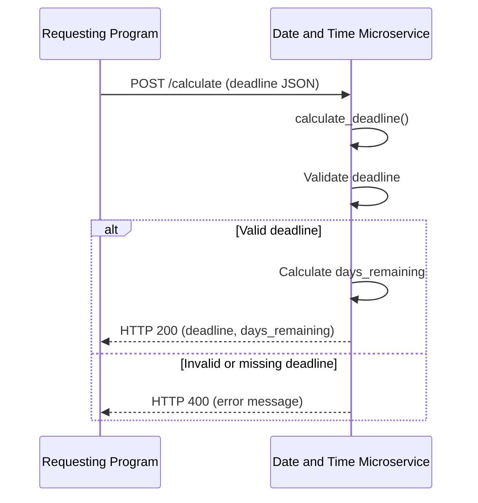

# Date and Time Microservice

## Description

This microservice calculates the number of days remaining until a specified deadline.

It validates submitted dates and returns an error for invalid input.

## Communication Contract

**Communication Pipe:** REST API

**Endpoint:** `http://127.0.0.1:5000/calculate`

**Method:** POST

**Data Format:** JSON

### Requesting Data

The requesting program sends an HTTP POST request containing a deadline in YYYY-MM-DD format.

Required parameter:
- `deadline`: Date in YYYY-MM-DD format.

Example request:

```python
import requests

response = requests.post(
    "http://127.0.0.1:5000/calculate",
    json={"deadline": "2026-12-01"}
)
```

### Receiving Data

The microservice returns a JSON response containing:

- `deadline`: The submitted deadline.
- `days_remaining`: Number of days until the deadline.

Example response:

```json
{
    "deadline": "2026-12-01",
    "days_remaining": 16
}
```

The number of days is calculated using the server's current local date.

Example receiving code:

```python
data = response.json()

print(data["deadline"])
print(data["days_remaining"])
```

### Error Handling

Invalid dates return HTTP 400.

Example:

```json
{
    "error": "Invalid deadline. Use YYYY-MM-DD format."
}
```

Missing required fields also return HTTP 400.

## Running the Microservice

Install dependencies:

```bash
python -m pip install flask requests
```

Start the server:

```bash
python date_time_service.py
```

In a separate terminal, run:

```bash
python test_date_time.py
```

## UML Sequence Diagram

